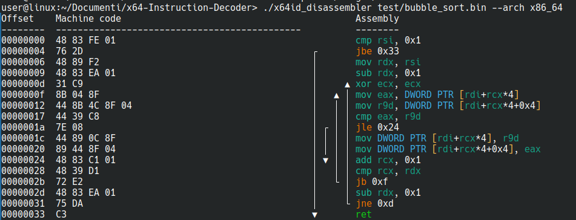

[](https://www.gnu.org/licenses/old-licenses/gpl-2.0.html)

<a id="x64id--machine-code-analyzer"></a>
# x64ID — x86 and x86_64 Instruction Decoder

x64ID is a C library for decoding x86 and x86_64 machine code. It reports
instruction length and encoding fields, and provides partial mnemonic
translation. The repository also includes a command-line disassembler for raw
binary files.

You can use x64ID in a disassembler, binary inspector, or instruction rewriter.
It does not currently read executable files such as ELF or PE.

## Contents

- [Features and scope](#supported-architectures-and-features)
- [Build](#build)
- [Command-line disassembler](#command-line-disassembler)
  - [Color configuration](#color-configuration)
- [Library API](#api)
  - [Decode an instruction](#decode-an-instruction)
  - [Optional instruction fields](#enabling--disabling-features)
  - [Function length helper](#find-function-length)
- [Tests and opcode coverage tools](#tests-and-opcode-coverage-tools)
- [Contributing opcode definitions](#contributing-opcode-definitions)
- [References](#useful-resources)
- [License](#license)

Links to sections in older versions of this README are kept where possible.

<a id="supported-architectures-and-features"></a>
## Features and scope

<a id="mnemonic-translation"></a>
- x86 and x86_64 decoding, including instruction prefixes, ModRM, SIB,
  displacement, immediates, REX, and VEX fields.
- Mnemonic and operand formatting for the opcode definitions in
  [`src/tools/definitions.txt`](src/tools/definitions.txt).
- A CLI that displays instruction bytes alongside assembly, marks in-file
  branch targets, and can export a plain-text listing.
- Unsupported or unmapped encodings are displayed as `db` bytes; decoding
  continues with the following instruction when its length can be determined.

Mnemonic coverage is incomplete. VEX/AVX support is partial; EVEX/AVX-512,
XOP, and 3DNow! are not supported. The test suite covers declared definitions,
not the entire x86 instruction set.

<a id="features-on-development"></a>
ELF and PE support and wider instruction coverage are planned. For now, provide
the decoder with the instruction bytes to read.

## Build

You need CMake 3.16 or newer, a C11 compiler, Python 3, and clang-format. CMake
finds clang-format automatically, including versioned commands such as
`clang-format-22`. The build formats the C files before compiling them.

From the repository root:

```sh
make                 # Configure in build/ and compile the project
make test            # Build the disassembler and run the automated suite
make help            # List targets, executables, and sample files
make clean           # Remove build output and generated test binaries
```

Set `BUILD_DIR` to use a different build directory:

```sh
make test BUILD_DIR=out
```

## Command-line disassembler

The CLI reads a raw byte stream and starts decoding at file offset zero. It
does not locate code sections in ELF or PE files. If you pass an ELF or PE file,
the program will treat its headers and other contents as instructions. Extract
the code bytes first.

Build and disassemble a sample:

```sh
make
./build/x64id_disassembler --arch x86_64 test/bubble_sort.bin
```

The screenshot shows the actual output, including the machine-code column,
colored assembly, and branch arrows:



`--arch` accepts `x86`, `x86_64`, `1`, or `2`. If omitted, the program asks
interactively. The input path may also be omitted to enter it interactively.
Use `--help` for the full option list.

Export the listing to a text file while also printing it to the terminal:

```sh
./build/x64id_disassembler --arch x86_64 \
  --output disassembly.txt test/bubble_sort.bin
```

The text export contains the byte and assembly columns without terminal color
codes. Branch arrows are shown in the left gutter for targets inside the input
buffer.

### Color configuration

By default, settings are read from `./disassembler.ini`. Select another file
with `--config FILE` or the `X64ID_DISASSEMBLER_CONFIG` environment variable.
The `enabled` setting accepts `auto` (color only on a terminal), `always`, or
`never`. The remaining keys select colors for instruction and operand parts:

```ini
[colors]
enabled = auto
mnemonic = cyan
jump = yellow
call = magenta
return = green
data = bright_black
register = bright_cyan
memory_size = bright_blue
brackets = bright_yellow
```

Color names are `black`, `red`, `green`, `yellow`, `blue`, `magenta`, `cyan`,
`white`, their `bright_` variants, `default`, and `none`.

<a id="api"></a>
## Library API

<a id="instruction-struct"></a>
<a id="rex-union"></a>
<a id="modrm-union"></a>
<a id="sib-union"></a>
<a id="vex_info-struct"></a>

Include [`src/x64id.h`](src/x64id.h). Set the architecture before decoding;
the decoder keeps this setting as global state until it is changed again.

### Decode an instruction

<a id="examples"></a>
<a id="a-practical-example-sum-of-two-vectors-using-simd-instruction"></a>
<a id="another-example-architecture-x64-vex-prefix-with-ymm-register"></a>

```c
#include <stdio.h>

#include "x64id.h"

char code[] = { (char)0x48, (char)0x89, (char)0xD8 }; /* mov rax, rbx */
x64id_set_arch(X64);

for (int offset = 0; offset < (int)sizeof(code);) {
    struct instruction instr;
    int length = x64id_decode(&instr, code, offset);
    if (length <= 0)
        break;

    for (int i = 0; i < length; i++)
        printf("%02X ", (unsigned)instr.instr[i]);
    printf(" %s\n", instr.disasm);
    offset += length;
}
```

This prints the instruction bytes followed by `mov rax, rbx`. After `make`,
compile the example with:

```sh
cc -Isrc example.c build/libx64id_decoder.a -o example
```

`x64id_decode` returns the decoded instruction length. The `instruction`
structure also exposes fields such as prefixes, ModRM, SIB, displacement,
immediate, branch target, and decoded operands. Raw bytes and VEX details are
enabled by default in the public header; see that header for the complete
structure and constants.

<a id="enabling--disabling-features"></a>
### Optional instruction fields

`_ENABLE_RAW_BYTES` stores the original bytes in `instr.instr`, while
`_ENABLE_VEX_INFO` enables the expanded VEX fields. Both are defined by
default in `src/x64id.h`. Changing them changes the public structure, so
rebuild all code that uses the library.

<a id="find-function-length"></a>
### Function length helper

[`src/utils/function_length.h`](src/utils/function_length.h) provides the
experimental `getFunctionLength(char *buffer)` helper. Call
`x64id_set_arch()` first. It follows direct branches and stops at `ret` or
`int3` (the `C3` and `CC` bytes). It does not handle jump tables and has no
buffer-size argument, so the memory it reads must remain valid for every path
it follows. The reported length is the span between the lowest and highest
visited addresses and may include gaps.

The `x64id` executable is a small decoder and function-length demonstration.
Its usage is listed by `make help`.

<a id="tests"></a>
## Tests and opcode coverage tools

Run the automated suite with:

```sh
make test
```

The suite builds byte sequences from `definitions.txt`, exercises supported
ModRM and addressing forms, and checks the CLI output in both architectures.
Its generated corpus is temporary. See [`test/README.md`](test/README.md) for
the test model and its limits.

Generate compact binaries with one representative encoding per declared
opcode, then inspect one with the CLI:

```sh
make opcode-sample ARCH=x86_64
./build/x64id_disassembler --arch x86_64 test/defined_opcodes_x86_64.bin
```

To scan opcode maps for encodings that currently fall back to `db` and print a
deduplicated report:

```sh
make inspect-opcode-sweep ARCH=x86_64
```

Use `ARCH=x86` for the 32-bit sweep. The full disassembly and missing-opcode
summary are saved under `/tmp` by default; see `test/README.md` for paths and
the `SWEEP_OUTPUT` and `SWEEP_MISSING` overrides. Sweep results identify
unrecognized encoding forms; they do not establish full ISA coverage.

## Contributing opcode definitions

Add or update entries in `src/tools/definitions.txt`, then regenerate the
dispatch header:

```sh
python3 src/tools/defs2header.py
```

The generated `src/tools/generated_opcodes.h` is included by the disassembler.
Definitions select both the mnemonic and an operand handler; consult
[`test/README.md`](test/README.md) when adding a new handler so the test
generator can construct its encoding forms.

## References

<a id="useful-resources"></a>
<a id="notes"></a>

- [Intel 64 and IA-32 Architectures Software Developer Manuals](https://www.intel.com/content/www/us/en/developer/articles/technical/intel-sdm.html)
- [x86-64 Instruction Encoding](https://wiki.osdev.org/X86-64_Instruction_Encoding)
- [Compiler Explorer](https://godbolt.org/)

## License

Copyright (C) 2020–2026 Marco 'DispatchCode' Crivellari.

This project is licensed under the GNU General Public License, version 2 only
(GPL-2.0-only). Copyright (C) 2020–2026 Marco 'DispatchCode' Crivellari.
See [`LICENSE`](LICENSE) for the full license text.
